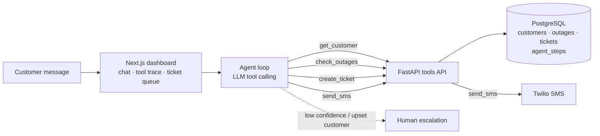

# Telecom Outage Assistant

An AI agent for telecom customer care. A customer writes *"my internet is down"*. The agent:

1. looks up the customer,
2. checks for a known outage in their area,
3. replies with the estimated restore time, or opens a ticket if no outage is known,
4. sends an SMS update,
5. hands the case to a human when it isn't confident or the customer is upset.

Every step the agent takes is logged, so a care agent can see exactly why it did what it did.

## Architecture



| Part | Tech |
|---|---|
| Agent | Python, Anthropic SDK tool calling (no framework) |
| Tools API | FastAPI |
| Data | PostgreSQL 16 |
| SMS | Twilio (falls back to logged "simulated" messages with no keys) |
| Dashboard | Next.js on Vercel |
| Ops | Docker Compose, GitHub Actions CI |

## Run it

```bash
cp .env.example .env          # add ANTHROPIC_API_KEY (Twilio keys optional)
docker compose up --build
curl localhost:8000/health    # {"status":"ok","customers":50,"active_outages":4}
```

The database is created and seeded on first start. To reset it: `docker compose down -v`.

## Seed data

`scripts/generate_seed.py` writes `db/02_seed.sql`: 10 service areas across Trinidad and Tobago, 50 invented customers (one per area guaranteed, phone numbers in the fictional 555 range) and six outages, four of them active:

| Area | Service | Cause |
|---|---|---|
| Port of Spain | fibre | Fibre cut during roadworks |
| Chaguanas | dsl | Power failure at exchange |
| San Fernando | mobile | Cell site hardware fault |
| Scarborough | fixed wireless | Storm damage to tower antenna |

Outage times are relative to when the database starts, so the ETAs always look current.

## Project layout

```
api/            FastAPI tools API (+ agent, coming next)
  app/main.py
  tests/
db/             schema and seed SQL, loaded by Postgres on first start
scripts/        seed generator
.github/        CI: loads the DB and runs the tests on every push
```

## Roadmap

- [x] Repo, Docker Compose, schema, seed data, CI
- [ ] Four tool endpoints: `get_customer`, `check_outages`, `create_ticket`, `send_sms`
- [ ] Agent loop with tool calling and human-escalation rule
- [ ] Log every agent step to `agent_steps`
- [ ] Next.js dashboard (conversation, tool trace, ticket queue)
- [ ] Test set of ~15 scripted customer messages checking tool choice
- [ ] Deploy and record a 2-minute demo
- [ ] Stretch: expose the tools as an MCP server
