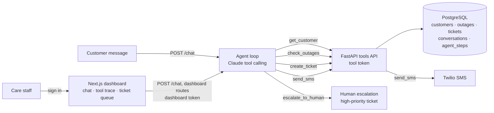

# Telecom Outage Assistant

An AI agent for telecom customer care. A customer writes *"my internet is down"*. The agent:

1. looks up the customer,
2. checks for a known outage in their area,
3. replies with the estimated restore time, or opens a ticket if no outage is known,
4. sends an SMS update,
5. hands the case to a human when it isn't confident or the customer is upset.

Every step the agent takes is logged, so a care agent can see exactly why it did what it did.

## Architecture



The model decides which tool to call and when; the tools API does the work. The agent never touches the database or Twilio directly, so every action is validated, logged and testable in one place. See [Security](#security) for who can call what.

| Part | Tech |
|---|---|
| Agent | Python, Anthropic SDK, native tool calling (no framework), Claude Opus 5.5 |
| Tools API | FastAPI, Pydantic |
| Data | PostgreSQL 16 |
| SMS | Twilio REST API (simulated when no keys are set) |
| Dashboard | Next.js 15, React 19, Tailwind CSS |
| Ops | Docker Compose, GitHub Actions CI |

## How the agent works

`POST /chat` takes one customer message and runs the loop in [`api/app/agent/loop.py`](api/app/agent/loop.py):

1. Log the message, then send the conversation history and five tools to Claude.
2. When Claude calls a tool, run it through the tools API and send the result back. Errors go back too, so the model can correct its input or ask the customer.
3. Repeat until Claude replies to the customer.

**Escalation.** The system prompt ([`prompt.py`](api/app/agent/prompt.py)) tells the agent to hand off instead of acting when the customer is upset or asks for a person, mentions safety or cancelling, asks about something outside outage triage, or when the agent isn't confident. It first asks for a phone or account number so the team can follow up, then calls `escalate_to_human`, which opens a high-priority `escalation` ticket and marks the conversation `escalated`. After that, new messages are recorded but the agent no longer acts on them.

**Guardrails.** Tool inputs use strict JSON schemas. The loop stops after 10 model calls, and a refusal, a cut-off response or a runaway loop all escalate to a human rather than fail. Server-side model fallback is on, so a request a safety classifier declines is retried on another model.

Some rules are enforced in code ([`tools.py`](api/app/agent/tools.py)), not just in the prompt, so a customer can't talk the agent around them:
- A conversation is bound to the first customer it identifies. `create_ticket` and `send_sms` only work for that customer.
- If a later `get_customer` finds a different customer, the agent doesn't switch accounts and doesn't see the second customer's details. The conversation escalates to a human instead.
- Once a conversation is escalated, no more tools run.

**Logging.** Every user message, model response, tool call, tool result and escalation is a row in `agent_steps`. The same log is replayed as the model's history on the next message, so the trace a care agent sees is exactly what the model saw.

## Run it

Needs Docker Desktop, Node.js 22 and an [Anthropic API key](https://console.anthropic.com/).

**1. Configure the API.** Copy the template and fill it in. Generate each secret with `python3 -c "import secrets; print(secrets.token_urlsafe(32))"`.

```bash
cp .env.example .env
# ANTHROPIC_API_KEY     your key
# POSTGRES_PASSWORD     a generated secret
# DATABASE_URL          postgresql://outage:<POSTGRES_PASSWORD>@localhost:5432/outage
# TOOLS_API_TOKEN       a generated secret
# DASHBOARD_API_TOKEN   a generated secret (also goes in web/.env.local)
```

**2. Start the database and API.**

```bash
docker compose up --build
curl localhost:8000/health    # {"status":"ok","customers":50,"active_outages":4}
```

The database is created and seeded on first start. To reset it: `docker compose down -v`. To run the API outside Docker instead (database still in Docker):

```bash
docker compose up -d db
cd api && ../.venv/bin/uvicorn app.main:app --port 8000 --env-file ../.env
```

**3. Talk to the agent.**

```bash
curl -s localhost:8000/chat -H 'content-type: application/json' \
  -d '{"message": "My internet has been down for an hour. My number is 868-555-1000"}'
```

```json
{
  "conversation_id": 1,
  "reply": "Sorry about the trouble, Kavita. Roadworks on Ariapita Ave cut a fibre cable, and that's causing an outage for fibre customers in Port of Spain, including you. Crews expect to have service back in about 2 hours. I've sent a text to your number with these details.",
  "status": "open",
  "tools_called": ["get_customer", "check_outages", "send_sms"],
  "steps": ["... the full trace for this message ..."]
}
```

Pass the returned `conversation_id` to continue the same conversation. Interactive API docs are off by default; set `ENABLE_API_DOCS=true` in `.env` to serve them at `localhost:8000/docs`.

### Dashboard

With the API running:

```bash
cd web
cp .env.example .env.local    # DASHBOARD_API_TOKEN (same as in ../.env), DASHBOARD_PASSWORD, SESSION_SECRET
npm install
npm run dev                   # http://localhost:3000, sign in with DASHBOARD_USER / DASHBOARD_PASSWORD
```

- **Conversations:** every conversation, newest activity first. Open one to read the transcript with each tool call and its result inline, plus the customer and any tickets. Type in the box to talk to the agent as a customer.
- **Ticket queue:** open tickets, high priority first. Change a ticket's status from the table.
- **SMS outbox:** every text the agent sent, including simulated ones.

The browser calls `/api/*` on the dashboard, and Next.js forwards those requests to the API (`API_URL`, default `http://localhost:8000`), so the API needs no CORS setup. Pages refresh every few seconds. Every page needs a staff sign-in; see [Staff login](#staff-login).

### Configuration

The API reads `.env` (template: [`.env.example`](.env.example)):

| Variable | Required | Purpose |
|---|---|---|
| `ANTHROPIC_API_KEY` | Yes, for `/chat` | Calls Claude |
| `POSTGRES_PASSWORD` | Yes | Database password. Compose won't start without it. Only applied when the database is first created; see [Changing the database password](#changing-the-database-password). |
| `DATABASE_URL` | Yes, outside Docker | Connection string for running the API or tests on your machine. Compose sets its own for the container. There is no built-in default. |
| `TOOLS_API_TOKEN` | Recommended | Token the agent sends to the tool endpoints. If unset, a random one is made at startup, which only works while the agent and API share one process. |
| `DASHBOARD_API_TOKEN` | Yes, for the dashboard | Token the dashboard's server sends to the dashboard endpoints. Must match `web/.env.local`. |
| `TWILIO_ACCOUNT_SID`, `TWILIO_AUTH_TOKEN`, `TWILIO_FROM_NUMBER` | No | All three set: real SMS. Otherwise SMS is saved with status `simulated`. |
| `SMS_REDIRECT_TO` | No | Sends every real SMS to this number instead. Twilio trial accounts can only text verified numbers, and the seeded customers are fake. |
| `TOOLS_API_URL` | No | Where the agent finds the tools API. Defaults to `http://localhost:8000`. |
| `ENABLE_API_DOCS` | No | `true` serves `/docs` and `/openapi.json`. Off by default. |
| `CHAT_RATE_PER_MINUTE`, `CHAT_RATE_PER_DAY`, `CHAT_GLOBAL_PER_DAY` | No | `/chat` rate limits (defaults 10, 100, 2000) |

The dashboard reads `web/.env.local` (template: [`web/.env.example`](web/.env.example)):

| Variable | Required | Purpose |
|---|---|---|
| `API_URL` | No | Where the dashboard forwards `/api/*` requests. Defaults to `http://localhost:8000`. Read at build time, so rebuild after changing it. |
| `DASHBOARD_API_TOKEN` | Yes | Same value as in the API's `.env` |
| `DASHBOARD_USER`, `DASHBOARD_PASSWORD` | Yes | The staff sign-in |
| `SESSION_SECRET` | Yes | Signs session cookies; at least 32 characters. Changing it signs everyone out. |
| `LOGIN_FAILURES_PER_IP`, `LOGIN_FAILURES_GLOBAL`, `STAFF_CHAT_PER_MINUTE` | No | Dashboard rate limits (defaults 5, 30, 20) |

Both env files are gitignored. Never commit them.

## Security

| Layer | What it does | Where |
|---|---|---|
| Caller tokens | Each caller has its own token, which only opens its own routes | [`auth.py`](api/app/helpers/auth.py) |
| Agent guardrails | The agent can only act on the customer it identified, and stops after escalating | [`tools.py`](api/app/agent/tools.py) |
| Staff login | Dashboard pages and data need a signed-in session | [`middleware.ts`](web/src/middleware.ts), [`staffAuth.ts`](web/src/lib/staffAuth.ts) |
| Rate limits | Caps on customer chat, staff chat and failed sign-ins | [`ratelimit.py`](api/app/helpers/ratelimit.py), [`rateLimit.ts`](web/src/lib/rateLimit.ts) |
| Infrastructure | No default credentials, localhost-only ports, docs off, locked-down container, security headers | [`docker-compose.yml`](docker-compose.yml), [`Dockerfile`](api/Dockerfile), [`next.config.ts`](web/next.config.ts) |

Input validation (Pydantic types and lengths) and parameterized SQL were there from the start.

### Who can call what

A missing or wrong token returns `401`. Tokens are compared in constant time.

| Caller | Sends | Can call |
|---|---|---|
| The agent | `Authorization: Bearer $TOOLS_API_TOKEN` | Tool endpoints: `/customers/lookup`, `/outages`, `POST /tickets`, `POST /sms` |
| The dashboard's server | `Authorization: Bearer $DASHBOARD_API_TOKEN` | Dashboard endpoints: `/conversations`, `GET /tickets`, `PATCH /tickets/{id}`, `GET /sms` |
| Anyone | nothing | `POST /chat` (the customer channel, rate-limited) and `GET /health` |

The agent's token can't read the dashboard, and the dashboard's token can't call tools.

### Staff login

Every dashboard page and `/api/*` call needs a signed-in session ([`middleware.ts`](web/src/middleware.ts)):
- **Without a session,** pages redirect to `/login` and `/api/*` returns `401`.
- **The session cookie** is signed with `SESSION_SECRET`, `HttpOnly` (page scripts can't read it) and `SameSite=Lax` (other sites can't make staff POST or PATCH). It lasts 8 hours.
- **When a request is forwarded to the API,** the Next.js server adds `DASHBOARD_API_TOKEN` and drops the cookie. The browser never sees the token.

For now there is one shared staff account, set in `web/.env.local`.

### Rate limits

Going over a limit returns `429` with a `Retry-After` header. Every limit can be changed in the env files.

| What | Default limit | Where |
|---|---|---|
| `POST /chat` per customer IP | 10 a minute, 100 a day | API |
| `POST /chat`, everyone together (customers and staff) | 2000 a day: a ceiling on model spend | API |
| Messages from the dashboard, per staff member | 20 a minute | Dashboard |
| Failed sign-ins per IP | 5 per 15 minutes | Dashboard |
| Failed sign-ins, everyone together | 30 per 15 minutes | Dashboard |

- **Staff aren't limited per IP at the API.** Everything from the dashboard arrives from the Next.js server's IP, so staff skip the API's per-IP limits and the dashboard limits them per person instead.
- **The per-IP sign-in limit can be bypassed.** Next.js passes a client's own `X-Forwarded-For` header through unchanged, so the client can fake its IP. The global cap still bounds password guessing, at the cost of briefly blocking sign-in for everyone during an attack.
- **Behind a reverse proxy,** have the proxy overwrite `X-Forwarded-For`, and run uvicorn with `--proxy-headers`, so the limits see real client IPs.
- **Counts are in memory.** That's correct for one API process and one dashboard server. With more of either, move the counts to Redis.

### Infrastructure

- **No default credentials.** The database password and connection string come from `.env`. Compose refuses to start without `POSTGRES_PASSWORD`, and the API refuses to connect without `DATABASE_URL`.
- **Localhost-only ports.** Compose publishes Postgres (5432) and the API (8000) on `127.0.0.1`, so other machines on the network can't reach them.
- **API docs off.** `/docs` and `/openapi.json` return `404` unless `ENABLE_API_DOCS=true`.
- **Locked-down API container.** The container runs as an unprivileged user (uid 10001), with a read-only filesystem, all Linux capabilities dropped and `no-new-privileges`.
- **Dashboard response headers.** Every response sends `Content-Security-Policy: frame-ancestors 'none'` and `X-Frame-Options: DENY` (no embedding in other sites), `X-Content-Type-Options: nosniff`, `Referrer-Policy: same-origin` and a `Permissions-Policy` that blocks camera, microphone and location. The `X-Powered-By` header is off.

CI uses throwaway `outage`/`outage` credentials for its own temporary database. They never reach a real deployment.

### Changing the database password

`POSTGRES_PASSWORD` is only read when the database is first created. To change it on an existing database without losing data:

```bash
NEW=$(python3 -c "import secrets; print(secrets.token_urlsafe(24))")
docker compose exec -T -e NEWPW="$NEW" db sh -c \
  'echo "ALTER USER outage PASSWORD :'"'"'pw'"'"';" | psql -q -v ON_ERROR_STOP=1 -U outage -d outage -v pw="$NEWPW"'
```

Then put the new value in `POSTGRES_PASSWORD` and `DATABASE_URL` in `.env`, and restart the API. To start fresh instead, `docker compose down -v` wipes the database, and the next start uses the password in `.env`.

### Known gaps and future work

- **Identity verification.** The agent takes the customer's word for who they are. Anyone who knows a customer's phone or account number can see that customer's name and outage status. A planned fix is for `get_customer` to ask the customer's account authorization question (the security question set on their account) and only unlock the account after a correct answer.
- **Organization sign-in.** The organization's LDAP directory or SSO provider (Azure AD/Entra ID, Okta, Google Workspace, any OIDC or SAML identity provider) can replace the shared account at a single point, [`web/src/lib/staffAuth.ts`](web/src/lib/staffAuth.ts):
  - **LDAP:** replace the body of `verifyCredentials()` with an LDAP bind.
  - **SSO:** replace the login form with a redirect to the identity provider, and have its callback call `createSession()` with the user's identity.

  Sessions, the middleware and the API token stay the same. Per-person accounts would also make the audit trail show who changed a ticket, and allow roles such as read-only staff.
- **Shared rate-limit counts.** Move them to Redis before running more than one API or dashboard process.
- **HTTPS.** Run both services behind a TLS-terminating reverse proxy when deploying. The session cookie is marked `Secure` automatically when the request arrives over HTTPS.

None of these are built yet; see the [roadmap](#roadmap).

## API

See [Who can call what](#who-can-call-what) for the token each endpoint needs.

| Endpoint | Tool | Does |
|---|---|---|
| `GET /customers/lookup?phone=` or `?account_no=` | `get_customer` | Finds a customer; accepts local phone formats like `555-1000` |
| `GET /outages?area_id=&service_type=` | `check_outages` | Active outages in an area, with `has_active_outage`, `minutes_until_eta` and `eta_overdue` |
| `POST /tickets` | `create_ticket` | Opens a fault ticket (category, priority, summary) |
| `POST /sms` | `send_sms` | Texts the customer at the number on their account; every attempt is recorded |
| `POST /chat` | | One customer message to the agent; returns the reply and trace |
| `GET /health` | | Database check |
| `GET /conversations?status=` | | Dashboard: conversations with customer, last message and tool-call count |
| `GET /conversations/{id}` | | Dashboard: one conversation's full step log and tickets |
| `GET /tickets?status=` | | Dashboard: ticket queue, high priority first |
| `PATCH /tickets/{id}` | | Dashboard: set a ticket's status (`open`, `in_progress`, `closed`) |
| `GET /sms` | | Dashboard: SMS outbox, newest first |

## Development

```bash
python3 -m venv .venv && source .venv/bin/activate
pip install -r api/requirements.txt
docker compose up -d db       # tests use the seeded database
set -a; source .env; set +a   # tests read DATABASE_URL from .env
cd api && pytest -q
```

The tests cover every endpoint, the agent loop and its guardrails, the caller tokens, the rate limits and the docs being off. Agent tests use a scripted stand-in for the model, so they need no API key and run in CI on every push. Tests clean up any rows they write.

## Seed data

`scripts/generate_seed.py` writes `db/02_seed.sql`: 10 service areas across Trinidad and Tobago, 50 invented customers (one per area guaranteed, phone numbers in the fictional 555 range) and six outages, four of them active:

| Area | Service | Cause |
|---|---|---|
| Port of Spain | fibre | Fibre cut during roadworks |
| Chaguanas | dsl | Power failure at exchange |
| San Fernando | mobile | Cell site hardware fault |
| Scarborough | fixed wireless | Storm damage to tower antenna |

Outage start times and ETAs are set relative to when the database is first created. After a few hours the ETAs pass and show as overdue; run `docker compose down -v && docker compose up -d db` to reseed with fresh times. This wipes conversations and tickets too.

## Project layout

```
api/
  app/
    main.py       FastAPI app: tool endpoints and POST /chat
    dashboard.py  read endpoints for the dashboard
    agent/        the care agent: loop, tools (with guardrails), prompt, conversation store
    models/       Pydantic request/response models
    helpers/      database, phone normalization, SMS delivery, caller tokens, rate limits
  tests/
web/              Next.js dashboard
  src/middleware.ts   staff session check; adds the API token to forwarded requests
  src/app/login/      sign-in page (src/app/auth/ has the login and logout routes)
  src/lib/            API client, session cookies, staff auth, rate limits
db/               schema and seed SQL, loaded by Postgres on first start
scripts/          seed generator
.github/          CI: runs the API tests against a seeded DB, and lints and builds the dashboard
```

## Roadmap

- [x] Repo, Docker Compose, schema, seed data, CI
- [x] Four tool endpoints: `get_customer`, `check_outages`, `create_ticket`, `send_sms`
- [x] Agent loop with tool calling and human-escalation rule
- [x] Log every agent step to `agent_steps`
- [x] SMS delivery: simulated by default (Twilio sign-up rejects Trinidad and Tobago numbers); real Twilio sending works once keys are set
- [x] Next.js dashboard (conversation, tool trace, ticket queue, SMS outbox)
- [x] Security: caller tokens, agent bound to the identified customer, staff login, rate limits, infrastructure hardening
- [ ] Verify the customer with their account authorization question before revealing account details or acting on the account
- [ ] Sign staff in through the organization's LDAP directory or SSO provider (OIDC/SAML) instead of the shared dashboard account, with per-person accounts and roles
- [ ] Shared rate-limit counts in Redis, for running more than one API or dashboard process
- [ ] Test set of ~15 scripted customer messages, scored on tool choice
- [ ] Deploy behind HTTPS and record a 2-minute demo
- [ ] Stretch: expose the tools as an MCP server
