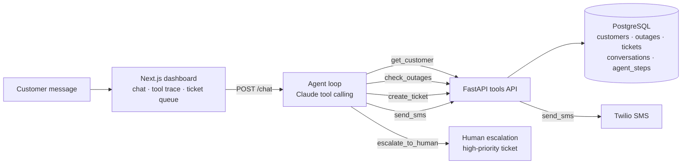

# Telecom Outage Assistant

An AI agent for telecom customer care. A customer writes *"my internet is down"*. The agent:

1. looks up the customer,
2. checks for a known outage in their area,
3. replies with the estimated restore time, or opens a ticket if no outage is known,
4. sends an SMS update,
5. hands the case to a human when it isn't confident or the customer is upset.

Every step the agent takes is logged, so a care agent can see exactly why it did what it did.

## Architecture



The model decides which tool to call and when; the tools API does the work. The agent never touches the database or Twilio directly, so every action is validated, logged and testable in one place.

| Part | Tech |
|---|---|
| Agent | Python, Anthropic SDK, native tool calling (no framework), Claude Opus 5.5 |
| Tools API | FastAPI, Pydantic |
| Data | PostgreSQL 16 |
| SMS | Twilio REST API (simulated when no keys are set) |
| Dashboard | Next.js 15, React 19, Tailwind CSS |
| Ops | Docker Compose, GitHub Actions CI |

## How the agent works

`POST /chat` takes one customer message and runs the loop in [`api/app/agent/loop.py`](api/app/agent/loop.py):

1. Log the message, then send the conversation history and five tools to Claude.
2. When Claude calls a tool, run it through the tools API and send the result back. Errors go back too, so the model can correct its input or ask the customer.
3. Repeat until Claude replies to the customer.

**Escalation.** The system prompt ([`prompt.py`](api/app/agent/prompt.py)) tells the agent to hand off instead of acting when the customer is upset or asks for a person, mentions safety or cancelling, asks about something outside outage triage, or when the agent isn't confident. It first asks for a phone or account number so the team can follow up, then calls `escalate_to_human`, which opens a high-priority `escalation` ticket and marks the conversation `escalated`. After that, new messages are recorded but the agent no longer acts on them.

**Guardrails.** Tool inputs use strict JSON schemas. The loop stops after 10 model calls, and a refusal, a cut-off response or a runaway loop all escalate to a human rather than fail. Server-side model fallback is on, so a request a safety classifier declines is retried on another model.

**Logging.** Every user message, model response, tool call, tool result and escalation is a row in `agent_steps`. The same log is replayed as the model's history on the next message, so the trace a care agent sees is exactly what the model saw.

## Run it

Needs Docker Desktop and an [Anthropic API key](https://console.anthropic.com/).

```bash
cp .env.example .env          # add ANTHROPIC_API_KEY (Twilio keys optional)
docker compose up --build
curl localhost:8000/health    # {"status":"ok","customers":50,"active_outages":4}
```

Talk to the agent:

```bash
curl -s localhost:8000/chat -H 'content-type: application/json' \
  -d '{"message": "My internet has been down for an hour. My number is 868-555-1000"}'
```

```json
{
  "conversation_id": 1,
  "reply": "Sorry about the trouble, Kavita. Roadworks on Ariapita Ave cut a fibre cable, and that's causing an outage for fibre customers in Port of Spain, including you. Crews expect to have service back in about 2 hours. I've sent a text to your number with these details.",
  "status": "open",
  "tools_called": ["get_customer", "check_outages", "send_sms"],
  "steps": ["... the full trace for this message ..."]
}
```

### Dashboard

With the API running:

```bash
cd web
npm install
npm run dev                   # http://localhost:3000
```

- **Conversations:** every conversation, newest activity first. Open one to read the transcript with each tool call and its result inline, plus the customer and any tickets. Type in the box to talk to the agent as a customer.
- **Ticket queue:** open tickets, high priority first. Change a ticket's status from the table.
- **SMS outbox:** every text the agent sent, including simulated ones.

The browser calls `/api/*` on the dashboard, and Next.js forwards those requests to the API (`API_URL`, default `http://localhost:8000`), so the API needs no CORS setup. Pages refresh every few seconds.

Pass the returned `conversation_id` to continue the same conversation. Interactive API docs are at `localhost:8000/docs`.

The database is created and seeded on first start. To reset it: `docker compose down -v`.

### Configuration (`.env`)

| Variable | Required | Purpose |
|---|---|---|
| `ANTHROPIC_API_KEY` | Yes, for `/chat` | Calls Claude |
| `TWILIO_ACCOUNT_SID`, `TWILIO_AUTH_TOKEN`, `TWILIO_FROM_NUMBER` | No | All three set: real SMS. Otherwise SMS is saved with status `simulated`. |
| `SMS_REDIRECT_TO` | No | Sends every real SMS to this number instead. Twilio trial accounts can only text verified numbers, and the seeded customers are fake. |
| `TOOLS_API_URL` | No | Where the agent finds the tools API. Defaults to `http://localhost:8000`. |
| `API_URL` (dashboard) | No | Where the dashboard forwards `/api/*` requests. Defaults to `http://localhost:8000`. |

## API

| Endpoint | Tool | Does |
|---|---|---|
| `GET /customers/lookup?phone=` or `?account_no=` | `get_customer` | Finds a customer; accepts local phone formats like `555-1000` |
| `GET /outages?area_id=&service_type=` | `check_outages` | Active outages in an area, with `has_active_outage`, `minutes_until_eta` and `eta_overdue` |
| `POST /tickets` | `create_ticket` | Opens a fault ticket (category, priority, summary) |
| `POST /sms` | `send_sms` | Texts the customer at the number on their account; every attempt is recorded |
| `POST /chat` | | One customer message to the agent; returns the reply and trace |
| `GET /health` | | Database check |
| `GET /conversations?status=` | | Dashboard: conversations with customer, last message and tool-call count |
| `GET /conversations/{id}` | | Dashboard: one conversation's full step log and tickets |
| `GET /tickets?status=` | | Dashboard: ticket queue, high priority first |
| `PATCH /tickets/{id}` | | Dashboard: set a ticket's status (`open`, `in_progress`, `closed`) |
| `GET /sms` | | Dashboard: SMS outbox, newest first |

## Development

```bash
python3 -m venv .venv && source .venv/bin/activate
pip install -r api/requirements.txt
docker compose up -d db       # tests use the seeded database
cd api && pytest -q
```

The tests cover every endpoint and the agent loop. Agent tests use a scripted stand-in for the model, so they need no API key and run in CI on every push. Tests clean up any rows they write.

## Seed data

`scripts/generate_seed.py` writes `db/02_seed.sql`: 10 service areas across Trinidad and Tobago, 50 invented customers (one per area guaranteed, phone numbers in the fictional 555 range) and six outages, four of them active:

| Area | Service | Cause |
|---|---|---|
| Port of Spain | fibre | Fibre cut during roadworks |
| Chaguanas | dsl | Power failure at exchange |
| San Fernando | mobile | Cell site hardware fault |
| Scarborough | fixed wireless | Storm damage to tower antenna |

Outage start times and ETAs are set relative to when the database is first created. After a few hours the ETAs pass and show as overdue; run `docker compose down -v && docker compose up -d db` to reseed with fresh times.

## Project layout

```
api/
  app/
    main.py       FastAPI app: tool endpoints and POST /chat
    dashboard.py  read endpoints for the dashboard
    agent/        the care agent: loop, tools, prompt, conversation store
    models/       Pydantic request/response models
    helpers/      database, phone normalization, SMS delivery
  tests/
web/              Next.js dashboard
db/               schema and seed SQL, loaded by Postgres on first start
scripts/          seed generator
.github/          CI: runs the API tests against a seeded DB, and lints and builds the dashboard
```

## Roadmap

- [x] Repo, Docker Compose, schema, seed data, CI
- [x] Four tool endpoints: `get_customer`, `check_outages`, `create_ticket`, `send_sms`
- [x] Agent loop with tool calling and human-escalation rule
- [x] Log every agent step to `agent_steps`
- [x] SMS delivery: simulated by default (Twilio sign-up rejects Trinidad and Tobago numbers); real Twilio sending works once keys are set
- [x] Next.js dashboard (conversation, tool trace, ticket queue, SMS outbox)
- [ ] Test set of ~15 scripted customer messages, scored on tool choice
- [ ] Deploy and record a 2-minute demo
- [ ] Stretch: expose the tools as an MCP server
